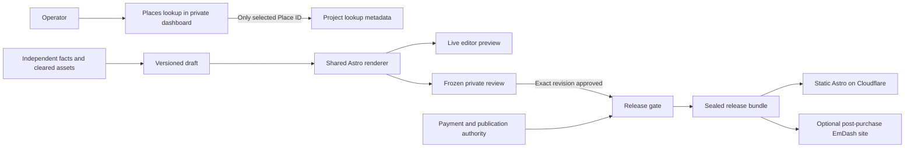

# Technical architecture

## Runtime and repository layout

Use a TypeScript and pnpm workspace with a committed lockfile. Pin the Node, pnpm, Astro, React, Wrangler, and EmDash combinations that pass the scaffold and CMS gates. Keep Wrangler environment bindings separate and document secret names with placeholder values. Use synthetic fixtures and local D1/R2 in development.

| Path | Responsibility |
| --- | --- |
| `apps/builder/` | Astro on-demand routes on Cloudflare Workers. React islands for forms and editing, shadcn/ui, Tailwind, and Motion. D1 for workflow data and private R2 for media and sealed artifacts |
| `apps/site/` | Static Astro build from one validated release bundle. Public deploy uses a dedicated Cloudflare Worker with Static Assets per site |
| `packages/contracts/` | Runtime schemas, source eligibility, revision and release transitions, and sanitized render models |
| `packages/landing/` | Shared Astro layout, section components, CTA handling, design tokens, and local font assets |
| `templates/emdash-site/` | Post-purchase Astro + EmDash Worker starter with per-site bindings, owner role and admin bootstrap runbook |
| `scripts/release/` | Build, scan, deploy, verify, and reconcile commands for an approved release |
| `tests/` | Synthetic fixtures, provider fakes, contract checks, and Playwright suites |

## Places lookup boundary

Start in manual mode. Enable live lookup per installation only after documenting the applicable Google billing region, approved use and field mask, privacy disclosures, and attribution review. Review the actual commercial flow against the applicable terms before enabling it, including restrictions on derived content and use in directory or advertising products. Keep lookup scoped to identifying an already-known business for a project. Avoid using it to build lead lists or enrich prospect records. If the review fails or remains unresolved, keep manual mode available.

- Accept deliberate name/locality search, pasted Place ID, or an HTTPS Google Maps URL from an exact host/path allowlist with an explicit supported Place ID parameter. Parse locally. Short or unsupported URLs fall back to manual search. Never fetch pasted URLs or follow redirects to resolve them.
- Call Places API (New) from the authenticated server route only. Text Search uses a bounded result list and an explicit mask such as `places.id,places.displayName,places.formattedAddress,places.attributions`. Place Details uses the equivalent unprefixed fields. Omit missing addresses for service-area businesses. Add fields only with an attribution, policy, and SKU review. A lookup feature flag, per-operator and installation-wide request limits, provider quotas, a bounded timeout, and bounded retries for transient errors keep usage controlled. Restrict the credential to Places API (New), use the application restriction supported by the chosen egress setup, and keep the key in server secrets.
- Return ephemeral display data with `Cache-Control: private, no-store`. Keep results in active page memory and clear them on selection or exit. Display Google Maps branding and applicable provider attribution inside the card. Suppress request bodies, result data, full URLs and query text from application logs, error reporting, analytics, and session replay. Never prefetch, bulk harvest, scrape Maps, or persist the result payload.
- Store the selected ID as a lookup reference after explicit operator confirmation, with selection time and actor. Authorize selection server-side using a short-lived signed assertion limited to IDs returned to that operator for that project. Store no Google display fields in the assertion. A stale or unresolved ID offers fresh lookup or manual intake. An ID is internal metadata and omitted from the portable release bundle.
- The page editor receives no provider payload. It starts empty or with layout defaults. The operator records owner-supplied or independently collected facts and marks how each was obtained. A tick box over a Places value cannot make it eligible. Keep Google reviews, photos, ratings, geometry, business details, and derived content out of all snapshots, LLM input, exports, and pages. Directions use an official Maps URL built from the independently verified public address, or a separately owner-supplied allowed link, with no map embed. Provide public Terms of Use and Privacy Policy with the Google disclosures and links required for the applicable integration.

References [Google terms](https://cloud.google.com/maps-platform/terms) · [Places policies and attribution](https://developers.google.com/maps/documentation/places/web-service/policies) · [Place IDs](https://developers.google.com/maps/documentation/places/web-service/place-id) · [Text Search](https://developers.google.com/maps/documentation/places/web-service/text-search) · [Credential security](https://developers.google.com/maps/api-security-best-practices) · [Maps URLs](https://developers.google.com/maps/documentation/urls/get-started)

## Data, generation, and rendering

| Record | Contract |
| --- | --- |
| Project | `id`, owner/studio scope, display label, optional internal Place ID, current draft version, publication target |
| Fact | `fieldKey`, typed value, `sourceKind` (owner or independent), source reference, checked actor/time. Independent evidence must be recorded outside the Google lookup |
| Media | Private object key, SHA-256, safe MIME, dimensions, alt text, rights basis and status, creator/credit where applicable. Freeze a content-addressed object in each snapshot |
| Draft | Mutable workspace state with integer version and schema version. Save with compare-and-set on the base version |
| Revision | Immutable, canonicalized snapshot with `id`, project ID, hash, schema version, render/template version, eligible facts, copy, theme, and asset digests |
| Review grant and decision | Project/revision ID, normalized email, role (viewer or approver), expiry, revocation, and decision/actor/time. New round supersedes old grants and decisions |
| Commercial evidence | Minimal opaque invoice reference, payment status, authority evidence reference, domain authorization, recorded actor/time. No payment credentials or card data |
| Release | Revision/hash, build hash, target, provider identifier, requester, idempotency key, status, and optional previous verified release. Keep a metadata-only audit trail |

Use route-level authorization even when the same operation is available from multiple screens. Reserve these entry points for the initial implementation.

| Method and path | Caller and effect |
| --- | --- |
| `POST /api/projects/:projectId/places/search` and `/api/projects/:projectId/places/select` | Operator. Search returns ephemeral cards. Select stores the confirmed ID for the scoped project |
| `PUT /api/projects/:projectId/draft` | Operator. Accepts base version and draft, returns new version or `409` without discarding client input |
| `POST /api/projects/:projectId/preview` | Operator. Renders the validated transient draft with inert contact actions |
| `POST /api/projects/:projectId/reviews` | Operator. Seals the revision and sets up the named review round |
| `GET /r/:revisionId` and `GET /r/:revisionId/media/:digest` | Reviewer. Resolve the current revision grant before rendering or serving bytes |
| `POST /r/:revisionId/decision` | Named approver. Accepts approval or change request for the frozen revision |
| `POST /api/projects/:projectId/releases` | Operator. Validates the gates and creates an idempotent release request |
| `GET /api/internal/releases/:releaseId/bundle` | Release job service identity. Serves only the sealed artifact for the claimed release |

D1 constraints and project-scoped foreign keys bind grants, revisions, and release history. Use atomic conditional writes for draft saves, review transitions, and release requests. Validate request schemas on the server. `Draft → Revision` freezes inputs. `Pending review → Approved | Changes requested | Superseded | Revoked | Expired` gates release. Expiry is checked at release authorization and again before deployment starts. An edited draft can coexist with an approved revision. Starting a new review invalidates the prior round. `Queued → Building → Deploying → Verifying → Live` has terminal `Failed` and recoverable `Needs reconciliation` branches.

Use deterministic templates as the default. Optional copy assistance consumes only explicitly selected, eligible input fields with operator opt-in. Treat sources as untrusted data. Require structured output with factual claims linked to source field IDs and reject unknown fields, markup, unsupported claims, and invalid contact destinations. The operator reviews and accepts proposals before they can enter a shareable revision. Model failure leaves the manual draft intact. Keep generated suggestions separate from evidence. No AI-generated code, unsupervised publication, or outbound tool access for the model.

Use `toRenderModel(revision)` as the shared mapping for live editor preview, frozen review, static Astro output, and EmDash seed. The live editor sends validated draft data to a protected Astro render route after a 300 ms debounce. Render in an iframe with a restricted sandbox and suppress CTA navigation in review surfaces. Ignore out-of-order responses. Freeze the render and asset versions for external review. Do not include reviewer metadata, provenance references, or private object keys in static HTML. Test normalized section markup and destinations across preview and static output, allowing for intentional preview controls and inert links.

## Authentication, private review, and uploads

- Use Cloudflare Access with separate applications/audiences for operator and reviewer hostnames. Pilot reviewers are manually enrolled for one-time PIN or an approved identity provider and separately granted a project revision in the app. Validate the signed Access JWT, issuer, audience, expiry, and normalized email at the Worker. The application checks operator membership or the live revision grant on every HTML, API, and protected media request. An opaque URL identifies a revision and carries no authority. Keep network-accessible builder deployments disabled until operator authentication and its origin bypass tests pass.
- Route protected requests through the Worker before static matching. Use private R2 with no public URL, disable alternate Workers hostnames and provider preview URLs, and exercise raw origin and asset paths in staging. Use `Cache-Control: private, no-store`, `X-Robots-Tag: noindex, nofollow, noarchive`, `Referrer-Policy: no-referrer`, and strict CSP. Limit framing to the intended builder origin or none. Never publish private preview builds as static assets.
- Use same-origin and CSRF checks on mutations, deny-by-default authorization, and parameterized SQL. Escape user text, constrain URLs by scheme and intended use, and reject raw HTML and custom scripts. Rate-limit mutations and authorization failures. Use identity and request IDs in security logs with no tokens, review contents, or raw personal details.
- Accept JPEG, PNG, and WebP via bounded upload streams. Initial limits are 5 MiB per file, 20 megapixels, and 10 images per project. Enforce limits on actual bytes, validate and decode input, re-encode to strip metadata, and reject SVG and remote asset fetching. Validate the Worker-compatible image processor in staging. If unavailable, keep uploads disabled and use the no-media layout until it passes. Serve private media through the same authorization layer.
- Keep review grants at seven days by default. Delete revoked/expired access and unpublished work after the documented retention window and applicable obligations. M6 defines explicit per-record retention and tests cleanup with a dry-run report. Audit events contain identifiers, timing, and status, with scoped operator access. Delete orphan uploads after a grace period and preserve assets referenced by live or rollback-eligible releases.

References [Cloudflare Access JWT validation](https://developers.cloudflare.com/cloudflare-one/access-controls/applications/http-apps/authorization-cookie/validating-json/) · [Worker static asset binding](https://developers.cloudflare.com/workers/static-assets/binding/) · [Worker preview URLs](https://developers.cloudflare.com/workers/versions-and-deployments/preview-urls/)

## Release and rollback

A protected operator action requests release for one approved revision and target. A manually dispatched, access-controlled CI job takes that release ID and retrieves its sealed bundle using a scoped service identity. Recheck reviewer decision, expiry/revocation, payment, owner authority, approved asset rights, destination, and template version before acquiring an exclusive publish lock. Once a deploy begins, treat it as potentially public. If a later reversal occurs, flag it for an authorized rollback or takedown.

Build from a fixed renderer commit and lockfile. Keep the handoff export portable by including the site source, cleared media, notices, and a deployment guide with placeholder configuration. Verify the sealed bundle hash, build offline from verified inputs after dependency installation, scan output for restricted data, private paths, secrets, and unsafe links, then record a build digest. Use environment-specific deploy credentials and a per-site Worker with an explicitly allowed hostname. Disable alternate deployment routes and prevent draft builds from receiving production credentials. Persist the provider version and confirm the expected release marker and contact behavior on the canonical URL before marking Live.

Serialize jobs per target. Claim releases via atomic state checks, enforce uniqueness of active releases per target, and keep an uncertain deployment locked until reconciliation. Use the provider's deployment/version record and the canonical release marker to decide whether to resume verification or retry. Retry only when the old attempt is known to be inactive. Rollback is an authorized, logged operation that promotes an eligible prior Worker version or redeploys its retained bundle and verifies it. For first-release takedown, use the documented deny/maintenance deployment and verify the public route. Retain prior approved artifacts only while their rights and retention allow rollback.

References [Astro on Workers](https://developers.cloudflare.com/workers/framework-guides/web-apps/astro/) · [Worker rollback](https://developers.cloudflare.com/workers/versions-and-deployments/rollbacks/)

## EmDash after purchase

Provision an isolated Astro + EmDash Worker with its own D1, private R2, and other bindings required by the pinned scaffold. Stage the site with bootstrap and admin routes gated. Finish first-admin setup on the final configured hostname or documented compatible origin before exposing the admin setup route. Use documented owner invitation and recovery mechanisms, scoped operator access, secret rotation at handoff, and no shared builder database. Keep optional plugins and MCP disabled until separately reviewed.

Use a versioned singleton landing schema and idempotent seeding keyed by the paid release ID and hash. Use a documented supported API or CLI for the pinned release. A failed seed leaves the static site serving. A rerun must leave owner edits intact. Check draft versus published content, media, owner permissions, and rendering parity before switching the canonical hostname. Keep the verified static release for authorized fallback. Back up CMS DB and media before migrations, verify migration state, and test a restoration. Worker code rollback alone cannot restore changed CMS data. After handoff, EmDash owns the content. Future builder imports require an explicit, reviewed handoff. Validate CMS edits against the same fact, asset, and safe-contact rules, with the business owner responsible for supplying eligible content.

References [EmDash on Workers](https://developers.cloudflare.com/workers/framework-guides/web-apps/emdash/) · [EmDash migration runbook](https://docs.emdashcms.com/deployment/core-migrations)

## Verification layers

Unit tests cover schemas, transitions, URL parsing, provenance and contact rendering. Integration tests run with local Worker bindings and fake providers, including concurrency, auth, storage, and sentinel leakage. Playwright checks review links, conflict handling, rendering parity, viewport sizes, keyboard use, and axe. Staging verifies Access and bypass paths against Cloudflare, permitted Google attribution and disclosure with a restricted key, real deploy and rollback, and EmDash setup plus recovery. Test production only on an authorized release. Report these evidence layers separately.
